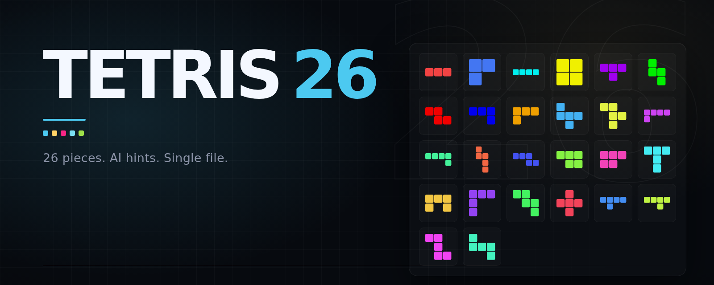

<p align="center">
  <a href="./README.md">English</a> · <a href="./README.zh-CN.md">简体中文</a>
</p>

<p align="center">
  
</p>

<h1 align="center">Tetris 26</h1>

<p align="center">
  26 pieces. An AI that scores every one and tells you where to put the current piece.<br>
  Play in your browser, or download a single file. No install.
</p>

<p align="center">
  
  
  
  
</p>

## What is this?

Tetris 26 is a falling-block game with 26 pieces: every connected polyomino of
3–5 cells that fits in a 4×4 box. It runs locally in your browser, and the same
game is available as a single executable with no runtime dependencies.

## Features

| Feature | What it does |
|---|---|
| **26 pieces** | All connected 3–5 cell polyominoes that fit in a 4×4 box. |
| **AI scoring** | Every piece gets a score for the current board. |
| **Difficulty slider** | Higher means you're more likely to get the hardest piece. |
| **Hints** | Three levels, from basic to advanced. |
| **7 themes** | Dark, pixel, neon, paper, ocean, sakura, and terminal. |
| **Single file** | No dependencies, no install. |

<p align="center">
  
</p>

## Themes

<p align="center">
  
</p>

## Download

| Platform | File |
|---|---|
| Linux | [`tetris26-linux`](../../releases/latest/download/tetris26-linux) |
| macOS | [`tetris26-macos`](../../releases/latest/download/tetris26-macos) |
| Windows | [`tetris26-windows.exe`](../../releases/latest/download/tetris26-windows.exe) |

On Linux and macOS, you may need `chmod +x` first. The game opens in your browser
at <http://localhost:8000>.

## Controls

| Key | Action |
|:---:|---|
| <kbd>←</kbd> <kbd>→</kbd> | Move |
| <kbd>↑</kbd> / <kbd>X</kbd> | Rotate clockwise |
| <kbd>Z</kbd> | Rotate counterclockwise |
| <kbd>↓</kbd> | Soft drop |
| <kbd>Space</kbd> | Hard drop |
| <kbd>C</kbd> | Hold |
| <kbd>A</kbd> | Cycle hints |
| <kbd>P</kbd> | Pause |
| <kbd>R</kbd> | Restart |

Touch controls are available on the game page.

## Run from source

Requires Python 3.11+ and [uv](https://docs.astral.sh/uv/).

```bash
uv sync
uv run python run.py
```

The server reads `.env` for `HOST`, `PORT`, `AUTO_OPEN`, and `PUBLIC`.

<details>
<summary>How the AI works</summary>

Each piece is scored by nine Dellacherie–Thiery features. Hints use a pruned
lookahead over the next pieces in the queue, with three strength levels. The
difficulty slider uses the same scores to sample among the hardest pieces.

The runtime is pure numpy; no ML framework is required. Difficulty scoring uses
the published DT-20 weights, and hints use the optional `tuned_weights.npz` when
it is present.

</details>

<details>
<summary>References</summary>

- Dellacherie (1988); Fahey (2003); Thiery & Scherrer (2009)
- DT-10/DT-20 weights: Gabillon et al. (2013); Scherrer et al. (2015); Chen et al. (2026, arXiv:2603.26765)
- "Hardest piece" rule: HATETRIS (qntm, 2010)

</details>

## License

MIT. See [LICENSE](LICENSE).

Tetris 26 is an independent project. It is not affiliated with or endorsed by
The Tetris Company. Tetris is a registered trademark of The Tetris Company.
