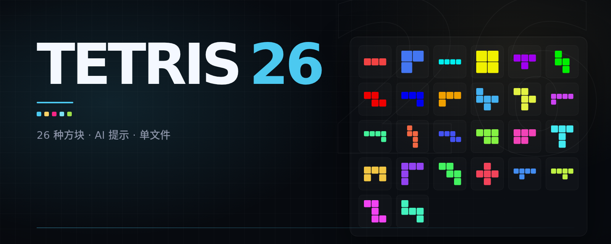

<p align="center">
  <a href="./README.md">English</a> · 简体中文
</p>

<p align="center">
  
</p>

<h1 align="center">Tetris 26</h1>

<p align="center">
  26 种方块。AI 会给每种方块打分，还会提示当前方块放哪。<br>
  浏览器里直接玩，也可以下载单文件，不用安装。
</p>

<p align="center">
  
  
  
  
</p>

## 这是什么

Tetris 26 是一个下落方块游戏，一共 26 种方块：所有能放进 4×4 方框、由 3–5 个格子连成的多格骨牌。
游戏在本地浏览器里运行，也可以下载成单文件可执行程序，不需要安装依赖。

## 特点

| 功能 | 说明 |
|---|---|
| **26 种方块** | 所有能放进 4×4 方框、由 3–5 个格子连成的多格骨牌。 |
| **AI 打分** | 每个方块都会根据当前局面得到一个分数。 |
| **难度滑块** | 数值越高，越容易拿到最难放的方块。 |
| **落点提示** | 三档强度，从基础到高级。 |
| **7 套主题** | 暗夜、像素、霓虹、纸白、深海、樱花、终端。 |
| **单文件** | 没有依赖，不用安装。 |

<p align="center">
  
</p>

## 主题

<p align="center">
  
</p>

## 下载

| 系统 | 文件 |
|---|---|
| Linux | [`tetris26-linux`](../../releases/latest/download/tetris26-linux) |
| macOS | [`tetris26-macos`](../../releases/latest/download/tetris26-macos) |
| Windows | [`tetris26-windows.exe`](../../releases/latest/download/tetris26-windows.exe) |

Linux 和 macOS 下可能要先 `chmod +x`。运行后浏览器会自动打开
<http://localhost:8000>。

## 操作

| 按键 | 功能 |
|:---:|---|
| <kbd>←</kbd> <kbd>→</kbd> | 移动 |
| <kbd>↑</kbd> / <kbd>X</kbd> | 顺时针旋转 |
| <kbd>Z</kbd> | 逆时针旋转 |
| <kbd>↓</kbd> | 软降 |
| <kbd>空格</kbd> | 硬降 |
| <kbd>C</kbd> | 暂存 |
| <kbd>A</kbd> | 切换落点提示 |
| <kbd>P</kbd> | 暂停 |
| <kbd>R</kbd> | 重开 |

游戏页面也提供了触屏按钮。

## 从源码运行

需要 Python 3.11+ 和 [uv](https://docs.astral.sh/uv/)。

```bash
uv sync
uv run python run.py
```

服务器会读取 `.env` 里的 `HOST`、`PORT`、`AUTO_OPEN` 和 `PUBLIC`。

<details>
<summary>AI 是怎么工作的</summary>

AI 用 9 个 Dellacherie–Thiery 特征给每个方块打分。落点提示会在后续方块队列上做剪枝搜索，
分三档强度。难度滑块用同一套分数，从最难的几个方块里抽样。

运行时只用 numpy，不需要机器学习框架。难度评分使用公开的 DT-20 权重；
如果目录里有 `tuned_weights.npz`，落点提示会使用它。

</details>

<details>
<summary>参考</summary>

- Dellacherie (1988)；Fahey (2003)；Thiery & Scherrer (2009)
- DT-10/DT-20 权重：Gabillon et al. (2013)；Scherrer et al. (2015)；Chen et al. (2026, arXiv:2603.26765)
- “最难方块”规则：HATETRIS（qntm, 2010）

</details>

## 许可证

MIT，详见 [LICENSE](LICENSE)。

Tetris 26 是独立项目，与 Tetris® 品牌及 The Tetris Company 没有关联，也没有获得其授权或背书。
